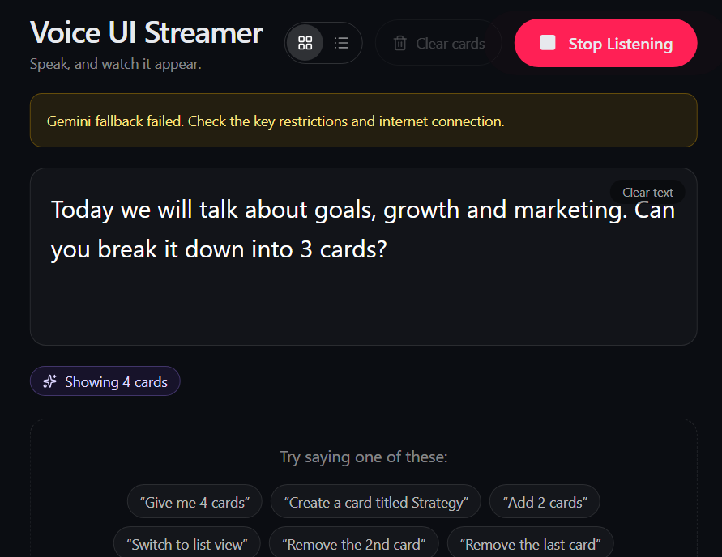

Voice UI Streamer is a browser app that listens to your microphone and turns speech into live transcript, cards, and diagrams in real time.

# Voice UI Streamer

## Demo



## Quick start (copy/paste)

```bash
cd /home/runner/work/Voice_UI_Streamer/Voice_UI_Streamer
pnpm install
```

```bash
# Terminal 1: API server (required for Gemini command parsing)
cd /home/runner/work/Voice_UI_Streamer/Voice_UI_Streamer
export PORT=5000
export GEMINI_API_KEY=your_key_here
pnpm --filter @workspace/api-server run dev
```

```bash
# Terminal 2: Voice UI app
cd /home/runner/work/Voice_UI_Streamer/Voice_UI_Streamer
export PORT=18789
export BASE_PATH=/
pnpm --filter @workspace/voice-ui-streamer run dev
```

Open http://localhost:18789 and allow microphone access.
